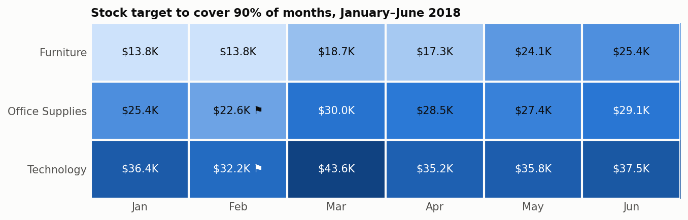

# Superstore Analysis

End-to-end analysis of four years of orders (2014–2017) from a US office-supplies retailer: what drives profit, how demand will move over the next six months, and what the business should do about both.

**Tools:** SQL (SQLite) · Python · Pandas · statsmodels · scikit-learn · Matplotlib · Power BI · pytest

One ETL builds a SQLite star schema that every analysis reads from. The analysis is split into three independent tracks:

| Track | Question | Status | Details |
|---|---|---|---|
| **Business diagnostics** | Which products, regions and customer segments make or lose money? | Done | [reports/diagnostics.md](reports/diagnostics.md) |
| **Demand forecasting** | How much will each category sell in the next six months? | Done: forecast and inventory plan for Jan–Jun 2018 | [reports/forecasting.md](reports/forecasting.md) |
| **Regression** | Which factors drive profit on an order line? | Planned | — |

## Headline results

### Business diagnostics

- **Discounts above ~20% destroy margin.** Furniture turns loss-making from the 21–30% discount band; no category is profitable above 40%.
- **Furniture sells but barely profits:** its margin fell to 1.4% in 2017 while sales kept growing.
- **Five states offset profit made elsewhere.** Texas alone lost \$25.7K; Ohio, Pennsylvania, Illinois and North Carolina are also net-negative.

### Demand forecasting

SARIMA was the most accurate model on a 12-month holdout (WAPE 19.8–32.3% per category, against 20.9–35.9% for the seasonal naive benchmark), with Total best forecast as the sum of the categories (WAPE 20.5%). Refitted on all four years, it forecasts January–June 2018:

| Category | H1 2018 forecast | vs H1 2017 | Stock target (90% service level) | Peak month |
|---|---|---|---|---|
| Furniture | \$84K | +22% | \$113K | June |
| Office Supplies | \$123K | +38% | \$163K | March |
| Technology | \$142K | +43% | \$221K | March |

- **Technology needs the most stock and the largest buffer:** 36% of its stock target is safety stock, because its forecast is the most uncertain.
- **Build stock ahead of March** for Office Supplies and Technology; **ramp Furniture up towards May–June**, without overstocking it: excess Furniture gets cleared with discounts, which the diagnostics show make it loss-making.
- **Keep January–February lean.** The model's February forecasts for Office Supplies and Technology are flagged for review: they sit far above last year's February.



## Roadmap

- [x] ETL: raw CSV → cleaned, validated SQLite star schema
- [x] Business diagnostics: growth, category, segment, discount and regional profitability
- [x] Forecasting: monthly series, trend and seasonality analysis, baselines, Holt-Winters, SARIMA
- [x] Forecasting: six-month forecast with confidence intervals and an inventory plan by category and month
- [ ] Regression: profit drivers (discount vs profit, category margins, shipping patterns), model, feature importance and interpretation
- [ ] Power BI dashboard: KPI overview, regional map, category drill-down
- [ ] Business recommendations combining all three tracks

## Project structure

```
├── data/raw/superstore.csv      Source data (see docs/dataset.md)
├── db/                          SQLite database, built by the ETL (git-ignored)
├── sql/
│   ├── etl/                     Star schema
│   ├── diagnostics/             Business diagnostics queries
│   └── forecasting/             Monthly sales series
├── src/
│   ├── config.py                Paths, tracks and the forecast holdout length
│   ├── etl.py                   Extract → clean → enrich → validate → load
│   ├── db_utils.py              SQLite connection and query helper
│   ├── sql_runner.py            Runs a track's queries and saves the results as CSV
│   ├── plotting.py              Shared chart style
│   └── forecasting/             Series, baselines, metrics, SARIMA selection, stock targets
├── notebooks/
│   ├── 01_etl_superstore.ipynb  The ETL step by step
│   ├── forecasting/             Exploration, model validation, forecast and inventory plan
│   └── regression/
├── outputs/                     Generated tables and figures, one folder per track
├── reports/                     Conclusions, one document per track
├── dashboards/                  Power BI
├── docs/                        Dataset description, ER diagram
└── tests/                       pytest suite, run in CI on every push
```

## How to run

Requires Python 3.9+.

```bash
# 1. Create an environment and install the dependencies
python -m venv .venv
source .venv/bin/activate
pip install -e .                       # add ".[prophet]" for the optional Prophet model

# 2. Build the SQLite database from the raw CSV
python -m src.etl

# 3. Run the SQL queries of every track (or name one: diagnostics, forecasting)
python -m src.sql_runner

# 4. Run the tests
pytest
```

Then open the notebooks in Jupyter or VS Code with the `.venv` kernel.
