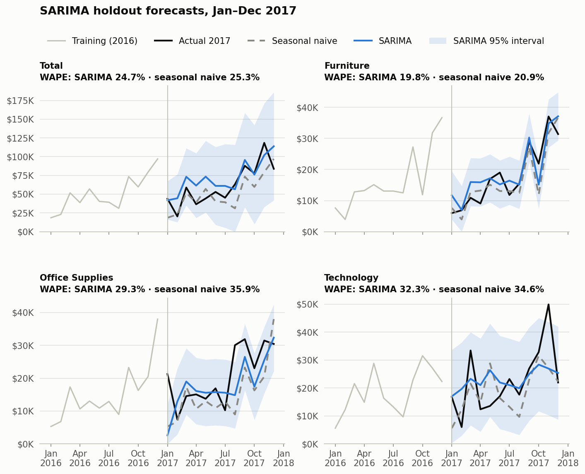
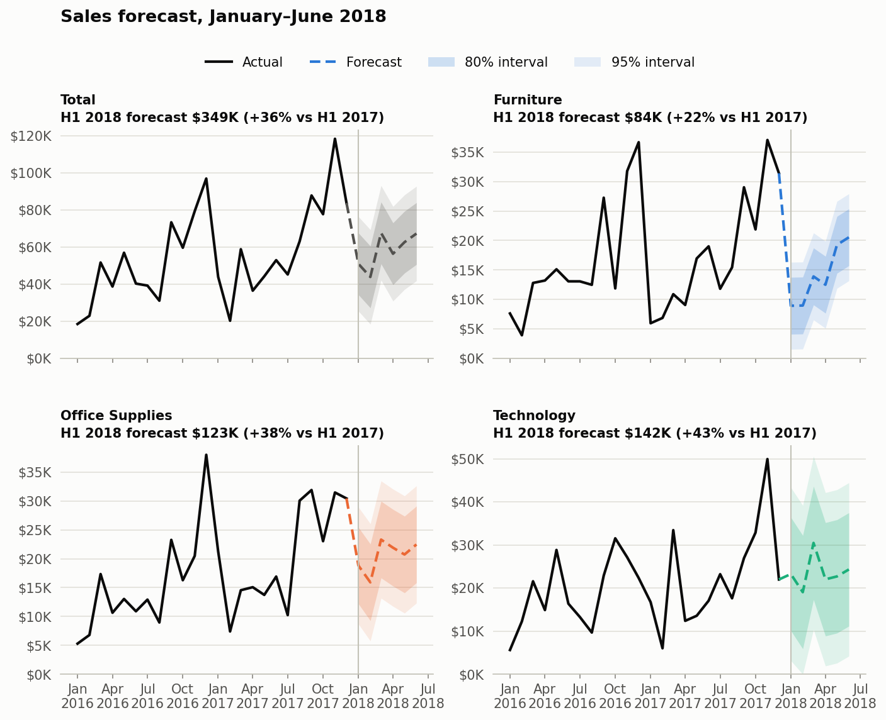
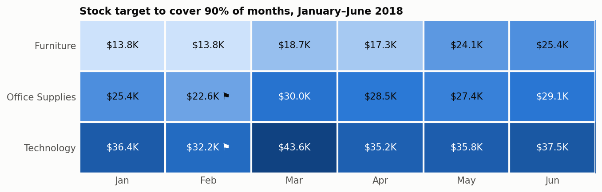

# Demand Forecasting: Main Conclusions

Monthly sales forecasting, in total and for each product category (Furniture, Office Supplies, Technology): a six-month forecast (January–June 2018) with confidence intervals, turned into inventory recommendations by category and month.

Based on the notebooks in `notebooks/forecasting/`. The monthly series come from `sql/forecasting/`, run with `python -m src.sql_runner forecasting`.

## Validation design

The last 12 months (Jan–Dec 2017) are held out. Every model is fitted on the 36 months from Jan 2014 to Dec 2016 and scored on 2017, which it never saw.

- **Every calendar month is tested once**, including the year-end peak, because the holdout is a full 12 months.
- **The holdout plays no part in any decision.** The exploration and the choice of Holt-Winters variant use the training months only, so the holdout error is an honest estimate of future error.
- **Every model family is tuned on the training months:** Holt-Winters variants and SARIMA orders are chosen by AICc, and SARIMA's differencing by the `auto.arima` rules (seasonal strength and KPSS).
- **WAPE is the headline metric:** total absolute error ÷ total sales. It weights each month by its sales, and the big months are where inventory money is. MAPE is reported alongside it.

## Holdout results

| Series | Naive | Seasonal naive (benchmark) | Holt-Winters | SARIMA |
|---|---|---|---|---|
| Total | 64.6% | 25.3% | 22.5% | 24.7% |
| Total, sum of category SARIMAs | — | — | — | **20.5%** |
| Furniture | 104.7% | 20.9% | 23.8% | **19.8%** |
| Office Supplies | 85.3% | 35.9% | **29.2%** | 29.3% |
| Technology | 38.9% | 34.6% | 33.5% | **32.3%** |

*WAPE on the 12 holdout months. Lower is better; bold marks the best forecast per series.*

- **Naive** repeats December 2016 for every month; **seasonal naive** repeats each month of 2016.
- **SARIMA beats the seasonal naive benchmark on all four series; Holt-Winters on three.** Holt-Winters loses on Furniture.
- **Holt-Winters forecasts are too low.** Sales grew 20.4% in 2017, and Holt-Winters under-forecast the year by 20.0%. AICc chose no trend for every series, because the flat 2015 made the growth look like noise.
- **SARIMA's drift term largely fixes this for the categories.** Bias is +7.6% for Furniture, −13.0% for Office Supplies and +1.6% for Technology, against −10% to −26% for Holt-Winters.
- **The direct SARIMA on Total overshoots by 17.4%,** because it is differenced twice and projects the strong end of 2016 forward. Adding up the three category forecasts instead gives the best Total forecast of any model: WAPE 20.5%, bias −1.5%.
- **SARIMA's 95% intervals are honest but wide.** 45 of 48 actual months fall inside them, but the bands span 118–195% of a month's actual sales.

**Model for the final forecast:** SARIMA for each category, with Total as the sum of the three. This is the most accurate option for every series except Office Supplies, where SARIMA and Holt-Winters tie (29.3% vs 29.2%) and SARIMA's bias is half as large. It also keeps the category plans consistent with the company total.

*Choosing between model families on the holdout makes the winner's WAPE slightly optimistic. Every choice within a family (orders, trend, variant) was made on the training months only.*

## Forecast and inventory plan, January–June 2018

From [04_forecast_inventory_plan.ipynb](../notebooks/forecasting/04_forecast_inventory_plan.ipynb). Each category's validated SARIMA specification is refitted on all 48 months; Total is the sum of the categories, with an interval that accounts for the correlation between their errors. Stock targets are set at a **90% service level**: stock should cover demand in 9 months out of 10. That is the forecast plus a safety stock of 1.28 standard errors.

| Category | H1 2018 forecast | vs H1 2017 | H1 stock target | Of which safety stock | Peak month | Lowest month |
|---|---|---|---|---|---|---|
| Furniture | \$84K | +22% | \$113K | \$29K (26%) | June | January |
| Office Supplies | \$123K | +38% | \$163K | \$40K (24%) | March | February |
| Technology | \$142K | +43% | \$221K | \$79K (36%) | March | February |
| **Total** | **\$349K** | **+36%** | | | | |

### Recommendations

1. **Technology needs the most inventory, and the largest buffer.** It has the highest and the most uncertain forecast: \$13K of safety stock every month, 36% of its stock target. Cover part of that buffer with faster replenishment or supplier agreements instead of stock on the shelf.
2. **Build stock ahead of March for Office Supplies and Technology.** March is their H1 peak (stock targets \$30.0K and \$43.6K), so orders belong in January–February.
3. **Ramp Furniture up from April towards May–June** (stock targets \$24–25K against \$14K in January–February), and do not go above the target. Furniture has the thinnest margin and turns loss-making with discounts above 20% ([diagnostics](diagnostics.md)), so excess Furniture stock cleared at a discount is the costliest overstock.
4. **Keep January–February lean, and review February before ordering.** The model's February forecasts for Office Supplies (\$15.9K) and Technology (\$19.0K) are far above last year's February grown at 2017's pace (\$9.9K and \$7.2K). The holdout showed the same weakness: Technology's February 2017 was forecast at \$19.7K against \$6.0K actual. Judgment call: plan Technology's February near \$20K (last year's level plus safety stock), not the model's \$32K target.
5. **Keep Office Supplies' safety stock.** SARIMA under-forecast Office Supplies by 13% in the holdout; the safety stock covers that risk.

### How far to trust the plan
- **The growth may be optimistic.** The H1 forecast grows +36% against +20% for all of 2017: the drift term carries forward the strong second half of 2017. Review the plan against January–February 2018 actuals as they come in.
- **The plan is in sales dollars.** Converting to units per product needs each category's product mix and prices.
- **The second half of 2018 is not covered.** September, November and December are the year's biggest months; re-run the forecast mid-year to plan for them.

## What the data shows

From the exploration of the 36 training months ([01_eda_trend_seasonality.ipynb](../notebooks/forecasting/01_eda_trend_seasonality.ipynb)):

1. **Seasonality is the main signal.** September, November and December sell 1.6–2.1× an average month; January and February only 0.2–0.6×.
2. **The seasonal shape is the same in all three categories.** All peak in Sep / Nov / Dec and bottom out in Jan / Feb, so one model family can serve every series.
3. **Month-to-month memory is weak.** The correlation with the previous month is 0.12–0.23, within noise. That is why the naive forecast fails and the seasonal naive forecast is the benchmark to beat.
4. **The trend is weak and uneven.** Total sales fell 2.8% in 2015 and rose 29.5% in 2016, too few data points to trust a straight-line trend.
5. **Furniture is the most predictable category; Technology the least.** Residual noise is 18% of mean sales for Furniture, 34% for Office Supplies and 37% for Technology, which sets a floor on achievable error.
6. **Additive vs multiplicative seasonality is not settled by inspection.** Total behaves additively, Furniture multiplicatively; the models test both.
7. **Stationarity tests disagree on differencing** (ADF vs KPSS, with only 36 months). SARIMA orders will be chosen from a small grid by AICc rather than fixed from the tests.

## Next steps

- [x] SARIMA, scored on the same holdout against seasonal naive and Holt-Winters
- [x] Six-month forecast (Jan–Jun 2018) with confidence intervals, including the bottom-up Total
- [x] Inventory recommendations by category and month
- [ ] Re-run mid-2018 with the first half of 2018 included, to plan the September–December peak
