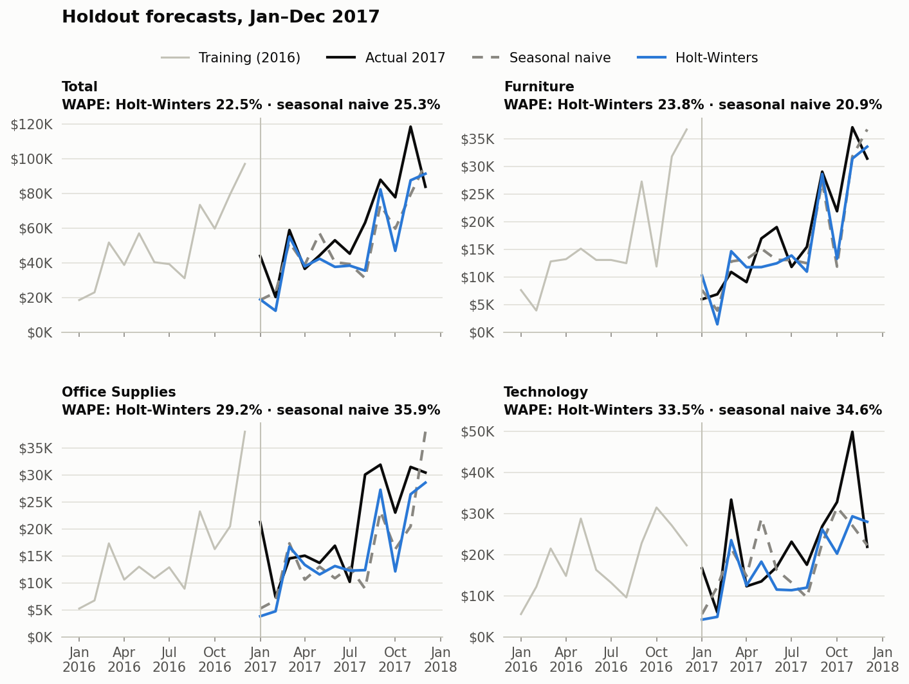
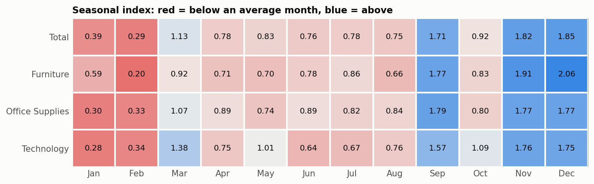

# Demand Forecasting: Main Conclusions

Monthly sales forecasting, in total and for each product category (Furniture, Office Supplies, Technology). The goal is a six-month forecast with confidence intervals that tells the business which categories and months need more inventory.

Based on the notebooks in `notebooks/forecasting/`. The monthly series come from `sql/forecasting/`, run with `python -m src.sql_runner forecasting`.

## Validation design

The last 12 months (Jan–Dec 2017) are held out. Every model is fitted on the 36 months from Jan 2014 to Dec 2016 and scored on 2017, which it never saw.

- **Every calendar month is tested once**, including the year-end peak, because the holdout is a full 12 months.
- **The holdout plays no part in any decision.** The exploration and the choice of Holt-Winters variant use the training months only, so the holdout error is an honest estimate of future error.
- **WAPE is the headline metric:** total absolute error ÷ total sales. It weights each month by its sales, and the big months are where inventory money is. MAPE is reported alongside it.

## Holdout results

| Series | Naive | Seasonal naive (benchmark) | Holt-Winters |
|---|---|---|---|
| Total | 64.6% | 25.3% | **22.5%** |
| Furniture | 104.7% | **20.9%** | 23.8% |
| Office Supplies | 85.3% | 35.9% | **29.2%** |
| Technology | 38.9% | 34.6% | **33.5%** |

*WAPE on the 12 holdout months. Lower is better; bold marks the best forecast per series.*

- **Naive** repeats December 2016 for every month; **seasonal naive** repeats each month of 2016.
- **Holt-Winters beats the seasonal naive benchmark on 3 of 4 series.** The gain on Technology is marginal, and on Furniture the benchmark wins.
- **Every forecast is too low.** Sales grew 20.4% in 2017, and Holt-Winters under-forecast the year by 20.0% (about 25% for Office Supplies and Technology). For inventory, that means stock-outs.
- **The under-forecast comes from the trend choice.** The Holt-Winters variant was chosen per series by AICc on the training months. All four came out as no trend with multiplicative seasonality, because the flat 2015 made the growth look like noise.

## What the data shows

From the exploration of the 36 training months ([01_eda_trend_seasonality.ipynb](../notebooks/forecasting/01_eda_trend_seasonality.ipynb)):

1. **Seasonality is the main signal.** September, November and December sell 1.6–2.1× an average month; January and February only 0.2–0.6×.
2. **The seasonal shape is the same in all three categories.** All peak in Sep / Nov / Dec and bottom out in Jan / Feb, so one model family can serve every series.
3. **Month-to-month memory is weak.** The correlation with the previous month is 0.12–0.23, within noise. That is why the naive forecast fails and the seasonal naive forecast is the benchmark to beat.
4. **The trend is weak and uneven.** Total sales fell 2.8% in 2015 and rose 29.5% in 2016, too few data points to trust a straight-line trend.
5. **Furniture is the most predictable category; Technology the least.** Residual noise is 18% of mean sales for Furniture, 34% for Office Supplies and 37% for Technology, which sets a floor on achievable error.
6. **Additive vs multiplicative seasonality is not settled by inspection.** Total behaves additively, Furniture multiplicatively; the models test both.
7. **Stationarity tests disagree on differencing** (ADF vs KPSS, with only 36 months). SARIMA orders will be chosen from a small grid by AICc rather than fixed from the tests.

## Next steps

- [ ] SARIMA (Prophet as an option), scored on the same holdout against seasonal naive
- [ ] Six-month forecast (Jan–Jun 2018) with confidence intervals, refitted on all 48 months
- [ ] Business conclusions: which categories and months need more inventory

Until a model removes the under-forecast, the upper confidence bound is a safer planning number than the point forecast, especially for Office Supplies and Technology.
